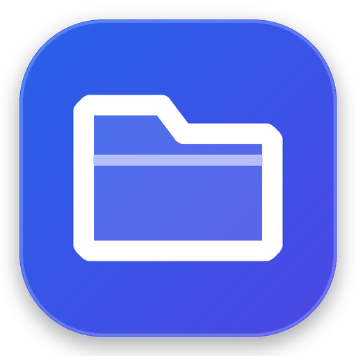
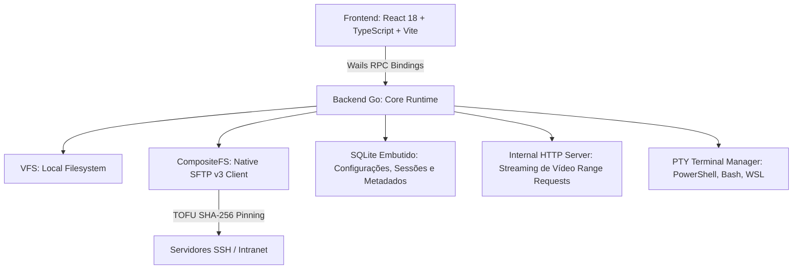

# Pulsares Explorer

<p align="center">
  
</p>

<p align="center">
  <strong>Explorador de arquivos multiplataforma com ferramentas integradas para desenvolvedores e fluxos técnicos.</strong><br>
  Desenvolvido em Go (Wails v2) + React 18 + TypeScript para Windows, Linux e macOS.
</p>

<p align="center">
  <a href="https://vitorkrewer.github.io/pulsares-file-explorer/"></a>
  <a href="CHANGELOG.md"></a>
  
  
  
  
  
  
  
  
  
</p>

---

## Sumário

- [Visão Geral](#visão-geral)
- [Destaques e Funcionalidades](#destaques-e-funcionalidades)
  - [Navegação, Abas e Painel Duplo](#1-navegação-abas-e-painel-duplo)
  - [Conexões Seguras SSH / SFTP (TOFU)](#2-conexões-seguras-ssh--sftp)
  - [Pré-visualizador Multimídia Avançado](#3-pré-visualizador-multimídia-avançado)
  - [Pulsares Studio Editor & DB Studio](#4-pulsares-studio-editor--db-studio)
  - [Busca Recursiva e Conteúdo em Streaming](#5-busca-recursiva-e-pesquisa-de-conteúdo)
  - [Terminal Integrado Multi-Shell](#6-terminal-integrado-multi-shell)
  - [Operações Atômicas e Desfazer (Undo/Redo)](#7-operações-atômicas-e-desfazer-undoredo)
  - [Produtividade & Utilitários](#8-produtividade--utilitários)
- [Arquitetura & Segurança](#arquitetura--segurança)
- [Atalhos de Teclado Essenciais](#atalhos-de-teclado-essenciais)
- [Como Compilar e Executar](#como-compilar-e-executar)
- [Documentação do Projeto](#documentação-do-projeto)
- [Licença](#licença)

---

## Visão Geral

O **Pulsares Explorer** é uma alternativa multiplataforma para organização e navegação de arquivos que reúne, em um único ambiente local, recursos voltados ao dia a dia de desenvolvedores, analistas de dados e usuários técnicos.

Construído com núcleo em **Go** e interface em **React + TypeScript**, o projeto combina gerenciamento de arquivos em múltiplas abas e painel duplo com ferramentas integradas que evitam a troca constante de aplicativos: **Terminal Multi-Shell**, **Pulsares Studio Editor** (com prévia web ao vivo), **Pulsares DB Studio** (inspeção de bancos SQLite/DuckDB e diagramas de entidade-relacionamento), **cliente SFTP nativo** e utilitários de verificação e comparação.

---

## Destaques e Funcionalidades

### 1. Navegação, Abas e Painel Duplo
- **Listagem Virtualizada em Streaming**: Diretórios contendo dezenas de milhares de arquivos abrem instantaneamente sem congelar a interface.
- **Sistema de Múltiplas Abas**:
  - Atalhos rápidos para abrir (`Ctrl+T`), fechar (`Ctrl+W`), duplicar, fixar/desafixar abas e reabrir abas fechadas (`Ctrl+Shift+T`).
  - Histórico independente de voltar/avançar e preservação completa da sessão no SQLite.
- **Painel Duplo (Dual Pane Commander)**:
  - Divisão horizontal ou vertical com divisor redimensionável.
  - Copiar (`F5`) e mover (`F6`) diretamente entre painéis no clássico estilo Commander.
- **Árvore de Pastas Hierárquica (`Sidebar`)**:
  - Carregamento preguiçoso com detecção assíncrona de subdiretórios.
  - Botão de colapsar todas as pastas abertas (`collapseAll`).
  - Ícones contextuais por tipo de diretório (`.git`, `node_modules`, `src`, `db`, pastas de código).
- **Barra de Navegação Amigável**:
  - Breadcrumbs interativos com suporte a caminhos locais e URIs remotas.
  - Botão discreto no final da barra para **Copiar caminho atual** com feedback visual imediato.

### 2. Conexões Seguras SSH / SFTP
- **Cliente Nativo SFTP v3 (Go)**:
  - Implementado sobre `golang.org/x/crypto/ssh`, sem depender de clientes OpenSSH instalados externamente.
- **Segurança Estrita com TOFU (Trust On First Use)**:
  - Verificação de chave pública do servidor via pinning de impressão digital SHA-256 (`SHA256:...`).
  - Alerta bloqueante e preventivo contra ataques *Man-in-the-Middle* (MITM) caso a chave do servidor mude.
- **Autenticação Multiformato & Proteção em RAM**:
  - Suporte a **Chave Privada SSH** com detecção automática de arquivos em `~/.ssh` (`id_ed25519`, `id_rsa`, `id_ecdsa`, etc.) e *passphrases*.
  - Suporte a **SSH Agent** do sistema operacional.
  - **Senha efêmera em RAM**: senhas e frases secretas permanecem exclusivamente na memória volátil durante a sessão ativa, sem qualquer gravação em disco.
- **Sistema de Arquivos Virtual (`CompositeFS`)**:
  - Permite navegar em pastas remotas (`sftp://<id>/...`), abrir no visualizador/editor, renomear, excluir, criar pastas e realizar transferências bidirecionais (Upload / Download) de forma transparente.
- **Atalho para Terminal SSH Interativo**:
  - Abra uma sessão de terminal conectada ao servidor com um único clique a partir da barra lateral ou do gerenciador de conexões.

### 3. Pré-visualizador Multimídia Avançado
- **Streaming de Vídeos Pesados (HTTP 206 Partial Content)**:
  - Servidor local interno com suporte completo a *Range Requests*, possibilitando reprodução fluida, *seeking* instantâneo e linha do tempo sem carregamento integral do arquivo na memória RAM.
- **Apresentações de Slides**:
  - Suporte nativo para apresentações do Microsoft PowerPoint (`.pptx`) e LibreOffice Impress (`.odp`), permitindo inspecionar slides, títulos, texto estruturado e anotações do apresentador.
- **Documentos e Código**:
  - Suporte a PDF, Markdown renderizado, código-fonte com syntax highlighting, áudios com player dedicado e imagens com zoom e rotação.
- **Visualização Rápida (Quick Look)**:
  - Pressione a tecla `Espaço` em qualquer item selecionado para abrir a pré-visualização instantânea em tela cheia.

### 4. Pulsares Studio Editor & DB Studio
- **Pulsares Studio Editor (`Ctrl+E` ou janela independente)**:
  - Editor de código e texto com múltiplas abas, árvore de arquivos do projeto e operações completas de arquivo pelo menu de contexto.
  - Prévia Web conectada em tempo real para projetos HTML, CSS e JavaScript locais.
  - Quebra automática de linhas (`Alt+Z`) e formatação para JSON, CSV, Markdown, TypeScript, JavaScript, Go e SQL.
  - Salvamento direto em arquivos locais e remotos via SFTP.
- **Pulsares DB Studio (integrado ou janela independente)**:
  - Visualizador, criador de tabelas e console SQL para bancos de dados **SQLite** (`.db`, `.sqlite`, `.sqlite3`) e **DuckDB**.
  - **Mapa ER (Diagrama de Entidade-Relacionamento)**: visualização interativa de tabelas, chaves primárias (PK) e chaves estrangeiras (FK) com auto-layout, busca, minimapa e exportação em SVG.
  - Inspeção de esquemas, paginação de registros, edição inline e exportação de resultados.

### 5. Busca Recursiva e Pesquisa de Conteúdo
- **Busca Avançada (`SearchDrawer`, `Ctrl+Shift+S`)**:
  - Pesquisa recursiva por padrão *glob* (`*.go`), expressões regulares (Regex), faixa de tamanho e intervalo de datas.
  - **Busca no Conteúdo dos Arquivos (Content Search)**: localiza palavras ou frases dentro de arquivos de texto e código, exibindo a linha de contexto (*snippet*).
  - **Streaming Progressivo**: resultados exibidos em lotes conforme são encontrados, com cancelamento imediato.
  - Indexação opcional em SQLite para buscas rápidas por nome em pastas cadastradas.

### 6. Terminal Integrado Multi-Shell
- **Painel Inferior Estilo VS Code (`` Ctrl+` ``)**:
  - Detecção automática de shells: PowerShell 7, Windows PowerShell, CMD, Git Bash, WSL, Bash, Zsh, Fish.
  - Abas independentes, renomeação inline, divisão horizontal e redimensionamento suave.
  - **Modo Follow-up**: quando ativado, a aba ativa do explorador acompanha automaticamente os diretórios navegados via `cd` no terminal (e vice-versa).
  - Encerramento limpo da árvore de processos ao fechar uma sessão.

### 7. Operações Atômicas e Desfazer (Undo/Redo)
- **Fila Assíncrona de Operações**:
  - Cópia e movimentação em segundo plano com cálculo de taxa de transferência (B/s), ETA e progresso item a item.
  - Escrita segura atômica com arquivos temporários `.pulsares-part` e `fsync`.
  - Verificação opcional de integridade pós-cópia via hash SHA-256.
- **Diário de Operações & Desfazer Global**:
  - Histórico de operações persistido no SQLite.
  - Desfaça (`Ctrl+Z`) e refaça (`Ctrl+Y`) ações de cópia, movimentação, criação de pastas, renomeações e envio para a lixeira.
- **Lixeira Nativa e Resolução de Conflitos**:
  - Suporte à lixeira nativa de cada sistema operacional (Windows Shell, FreeDesktop Trash, macOS Trash).
  - Diálogo de conflito com ações granulares: sobrescrever, pular, renomear automaticamente ou manter o mais recente.

### 8. Produtividade & Utilitários
- **Paleta de Comandos (`Ctrl+Shift+P`)**:
  - Acesso rápido a todas as funções e comandos do explorador por meio de busca textual.
- **Renomeação em Lote com Prévia (`F2` em múltiplos arquivos)**:
  - Substituição por texto ou Regex, prefixo, sufixo, alteração de maiúsculas/minúsculas e numeração sequencial.
  - Detecção preventiva de colisões de nome antes da aplicação.
- **Comparador de Diretórios**:
  - Comparação lado a lado entre pastas, identificando itens idênticos, modificados ou exclusivos.
- **Calculadora e Verificador de Checksums**:
  - Cálculo simultâneo em passagem única de `MD5`, `SHA-1` e `SHA-256` para conferência de integridade.
- **Gerenciador de Arquivos Compactados**:
  - Inspeção sem descompactação, criação e extração de pacotes `.zip`, `.tar`, `.tar.gz` e `.tgz` (com proteção anti-Zip-Slip).
- **Ícones Especializados**:
  - Visual moderno com ícones específicos para cada linguagem de desenvolvimento, banco de dados e tipo de arquivo de mídia ou sistema.

---

## Arquitetura & Segurança

O Pulsares Explorer foi construído sob o princípio de **Segurança por Padrão** (*Security by Design*) e **Privacidade Total**:



- **Isolamento de Credenciais**: Senhas de servidores SSH ou chaves privadas são mantidas exclusivamente na memória volátil durante a execução. Nenhum dado sensível de autenticação é gravado em disco.
- **TOFU Host Verification**: Conexões SSH exigem validação explícita da impressão digital da chave do servidor, prevenindo ataques de interceptação na rede.
- **100% Offline e Privado**: O aplicativo não realiza requisições externas para rastreamento, telemetria ou análises. Todas as dependências e ícones são empacotados localmente.

---

## Atalhos de Teclado Essenciais

| Atalho | Ação |
| :--- | :--- |
| `Ctrl+Shift+P` | Abrir Paleta de Comandos |
| `Ctrl+T` | Abrir Nova Aba |
| `Ctrl+W` | Fechar Aba Atual |
| `Ctrl+Shift+T` | Reabrir Última Aba Fechada |
| `Ctrl+Tab` / `Ctrl+1..9` | Alternar entre Abas |
| `Ctrl+B` | Alternar Painel Lateral (Árvore de Pastas) |
| `Ctrl+`` | Alternar Painel do Terminal Integrado |
| `Ctrl+E` | Abrir Pulsares Studio Editor |
| `Ctrl+Shift+S` | Abrir Busca Avançada e de Conteúdo |
| `Ctrl+F` | Focar Filtro Instantâneo na Pasta Atual |
| `Espaço` | Prévia Rápida em Tela Cheia (Quick Look) |
| `F2` | Renomear Item (ou Renomeação em Lote com seleção múltipla) |
| `F5` / `F6` | Copiar / Mover Seleção para o Painel Oposto |
| `Ctrl+Z` / `Ctrl+Y` | Desfazer / Refazer Última Operação |
| `Alt+Enter` | Propriedades do Item / Pasta |
| `Ctrl+Shift+N` | Criar Nova Pasta |

---

## Como Compilar e Executar

### Pré-requisitos
- **Go 1.24+**: [golang.org](https://golang.org/dl/)
- **Node.js 18+** e **npm**: [nodejs.org](https://nodejs.org/)
- **Wails CLI v2**:
  ```bash
  go install github.com/wailsapp/wails/v2/cmd/wails@latest
  ```

### Modo de Desenvolvimento
Para rodar a aplicação com recarregamento a quente (*live reload* do frontend e recompilação do backend):
```bash
wails dev
```

### Compilação de Produção
Para gerar o executável final otimizado:
```bash
# 1. Compilação do bundle frontend
cd frontend
npm run build
cd ..

# 2. Compilação do binário da aplicação
wails build -skipbindings
```
O executável compilado estará localizado em `build/bin/pulsares-explorer.exe` (no Windows) ou `build/bin/pulsares-explorer` (no Linux/macOS).

---

## Documentação do Projeto

- [CHANGELOG.md](CHANGELOG.md) — Histórico detalhado de alterações por versão.
- [AGENTS.md](AGENTS.md) — Diretrizes de desenvolvimento, regras de arquitetura e padrões de código.
- [docs/features.md](docs/features.md) — Catálogo de funcionalidades por módulo.
- [docs/architecture.md](docs/architecture.md) — Desenho da arquitetura, contratos e fluxos.
- [docs/roadmap.md](docs/roadmap.md) — Roteiro de versões e marcos do projeto.

---

## Licença

Distribuído sob a licença **MIT**. Consulte o arquivo [LICENSE](LICENSE) para obter mais informações.
