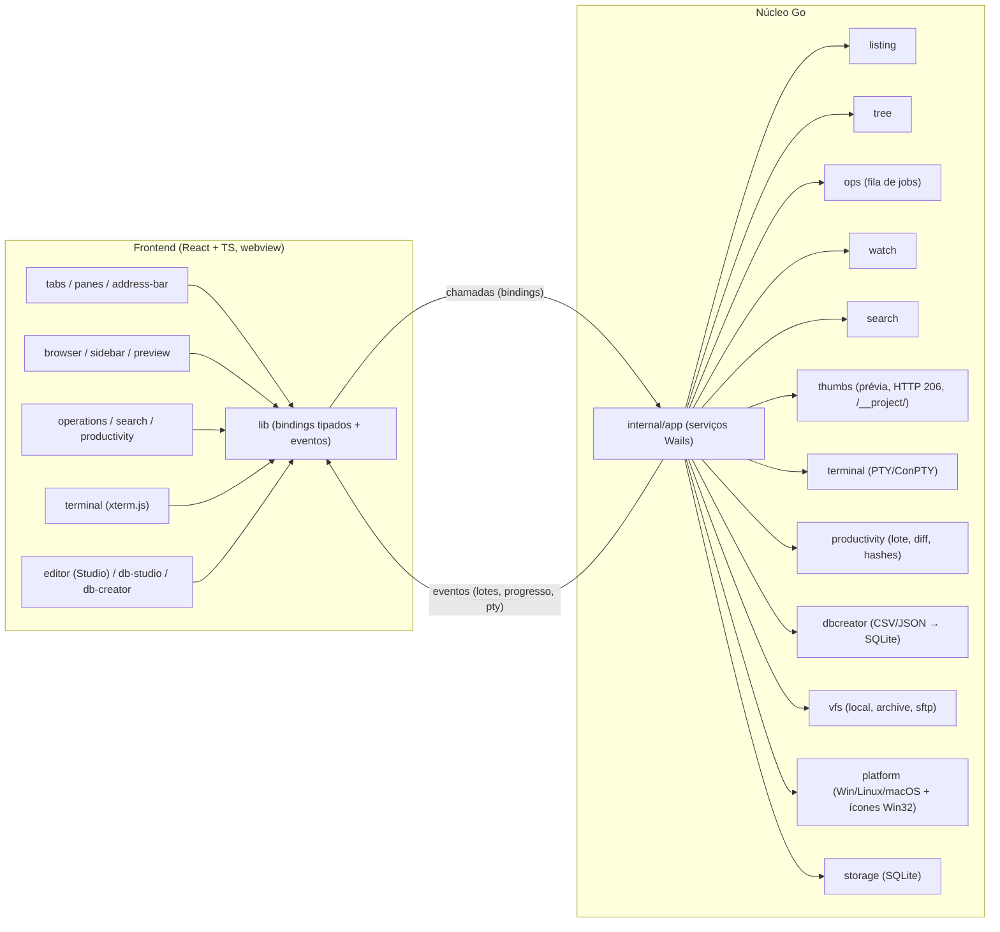
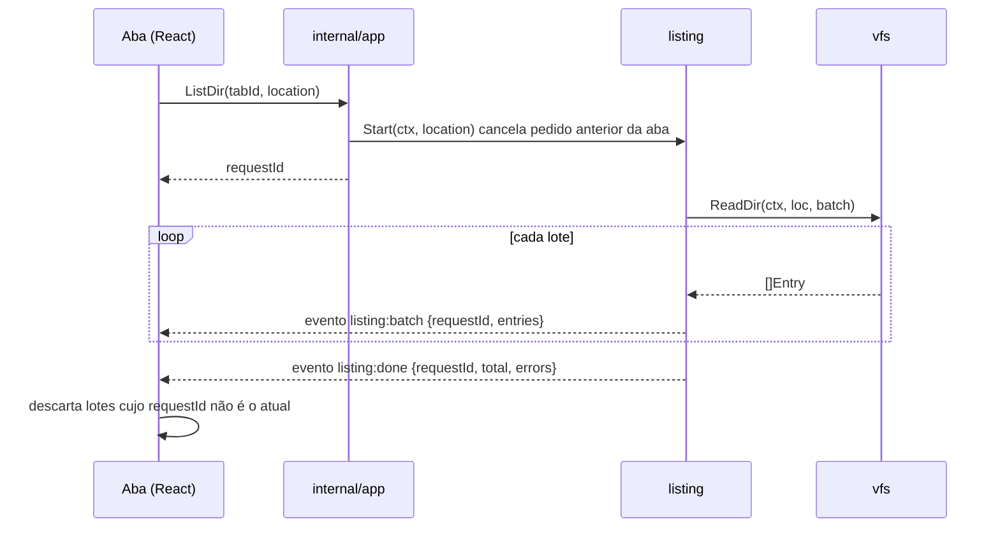
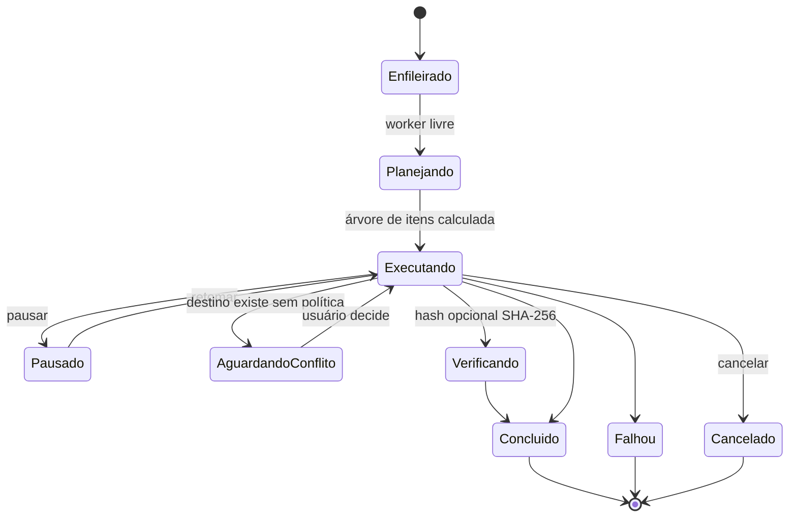
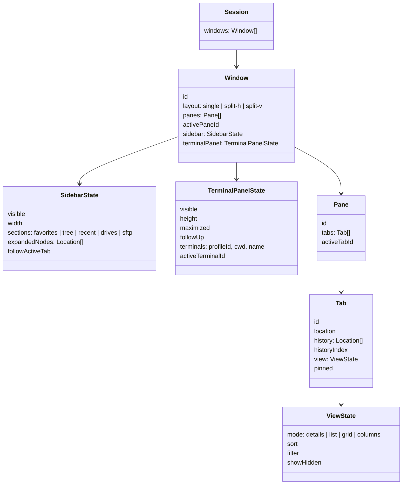

# Arquitetura

## Visão geral



Dois canais principais entre frontend e Go:

1. **Chamadas** (bindings Wails em `internal/app`): pedidos curtos ou disparo de operações assíncronas que retornam imediatamente um `requestId` / `jobId`.
2. **Eventos** (Wails `EventsEmit`): resultados progressivos — `listing:batch`, `listing:done`, `ops:progress`, `watch:changed`, `search:batch`, `search:done`, `terminal:data` e progresso de importação do `dbcreator`.
3. **AssetServer HTTP local** (`internal/thumbs/media_server.go`): serve vídeos, áudios e PDFs via **HTTP 206 Partial Content (Range Requests)** e arquivos de projetos web locais em `/__project/<base64_dir>/<relPath>`.

## Janelas independentes e identidade nativa

O binário único (`main.go`) suporta inicialização desacoplada por argumentos CLI:

- Padrão: **Pulsares Explorer** (`AppUserModelID`: `Pulsares.Explorer`, classe Win32 `PulsaresExplorerWindow`).
- `--studio [pasta|arquivo]`: **Pulsares Studio Editor** (`Pulsares.StudioEditor`, classe `PulsaresStudioEditorWindow`).
- `--dbstudio [banco.db]`: **Pulsares DB Studio** (`Pulsares.DBStudio`, classe `PulsaresDBStudioWindow`).

No Windows, `internal/platform/window_icon_windows.go` injeta ícones nativos (`WM_SETICON` / `SetClassLongPtrW`) e `AppUserModelID` dedicado para manter cada janela separada na barra de tarefas; em Linux/macOS, `internal/platform/window_icon_other.go` fornece stubs sem dependência de Win32.

## Contrato VFS

O núcleo evita chamar `os.*` fora de `vfs/local`. Os provedores em `internal/vfs/` (`local`, `archive`, `sftp`) são integrados via `CompositeFS`:

```go
// internal/vfs
type Location struct {
    Provider string // "local", "archive", "sftp"
    Root     string // ex.: "C:\\", "/", "sftp://profileId"
    Path     string // caminho normalizado dentro do provedor
}
```

- **`local`**: sistema de arquivos nativo com leitura em lotes, symlinks/junctions e atributos por SO.
- **`archive`**: leitura sem extração (`ListArchive`), criação (`CreateArchive`) e extração com proteção anti-**Zip-Slip** (`.zip`, `.tar`, `.tar.gz`, `.tgz`).
- **`sftp`**: cliente nativo SFTP v3 (`golang.org/x/crypto/ssh` + `ssh/agent`), verificação **TOFU (SHA-256 Pinning)** e credenciais voláteis mantidas exclusivamente em memória RAM.

Erros de domínio padronizados são convertidos em códigos estáveis na fronteira Wails para tradução no frontend.

## Fluxo: listar uma pasta



- Ordenação e filtragem ocorrem de forma rápida sobre os itens em memória com `Intl.Collator` e virtualização via `@tanstack/react-virtual`.

## Fluxo: operação de arquivo (job)



- **Escrita atômica**: temporário `.nome.pulsares-part`, `fsync` e rename atômico, com limpeza em caso de falha ou cancelamento.
- **Proteções contra loops e auto-drop**: detecção de movimentação no mesmo diretório (`no-op` seguro) e bloqueio contra mover/copiar diretório para dentro de seus próprios descendentes (`isSameOrDescendant`).
- **Diário (`op_journal`)**: registra ações no SQLite para Desfazer (`Ctrl+Z`) e Refazer (`Ctrl+Y`).

## Abas, sessão e barra lateral



- Ao recolher a barra lateral (`Ctrl+B`), entra em cena a **Activity Bar** vertical com gaveta flutuante (**Flyout**) que se auto-oculta após navegar, clicar fora ou pressionar `Escape` (com opção *Pin*).
- A árvore de pastas (`internal/tree`) é única por janela e acompanha o painel/aba em foco com carregamento preguiçoso e virtualização.

## Internacionalização

- **10 idiomas suportados**: `pt-BR` (referência), `en`, `es`, `de`, `fr`, `it`, `ja`, `zh-CN`, `tr` e `sv`, em `frontend/src/i18n/locales/<idioma>/common.json`.
- **Resolução**: `settings.language = "auto"` mapeia o idioma do SO para o catálogo suportado mais próximo (com `en` como fallback). Troca em tempo de execução sem reiniciar.
- **Formatação**: utilitários em `frontend/src/i18n/format.ts` usando `Intl` (`DateTimeFormat`, `NumberFormat`, `Collator`).
- **Validação**: `npm run i18n:check` (`frontend/scripts/check-i18n.js`) verifica paridade de chaves em todos os 10 idiomas, além da pseudo-localidade (`VITE_LOCALE=pseudo`).

## Terminal integrado

- **Backend (`internal/terminal`)**: pseudoterminal nativo (ConPTY no Windows, PTY no Linux/macOS), saída em lotes base64 (~8 ms ou 64 KB) com contrapressão (`Ack`), citação de caminhos específica por `ShellKind` e encerramento completo da árvore de processos filhos.
- **Frontend (`features/terminal`)**: `xterm.js` com abas, divisão lado a lado, busca na saída, links clicáveis e detecção de mudança de pasta tanto por sequências **`OSC 7`** quanto pelo botão **Follow-up** (detecção dupla cliente em `resolveClientCdCommand` + backend em `detectCdTarget`).
- **Privacidade**: o conteúdo digitado e a saída do terminal nunca são gravados em disco ou logs.

## Studio Editor, DB Studio e Criador SQLite

- **Pulsares Studio Editor (`features/editor`)**: abre arquivos ou pastas inteiras (`workspaceDir`), inclui menu de contexto completo em `ARQUIVOS DO PROJETO` e conecta alterações vivas de abas `.css` e `.js` à renderização de `.html` via `buildConnectedWebPreviewDoc` + servidor local `/__project/`.
- **Pulsares DB Studio (`features/db-studio`)**: lê bancos SQLite/DuckDB com PRAGMAs de alta velocidade (`cache_size = -64000`, `mmap_size = 268435456`, `temp_store = MEMORY`), contagem O(1) via `sqlite_sequence`, console SQL, exportação nativa CSV/JSON e **Mapa ER Interativo (`ERDiagramView.tsx`)** construído a partir de `PRAGMA foreign_key_list` com exportação vetorial SVG.
- **Criador SQLite (`internal/dbcreator` + `features/db-creator`)**: analisa `.csv`, `.tsv`, `.tab`, `.json`, `.jsonl` e `.ndjson`, infere delimitadores e tipos (`INTEGER`, `REAL`, `BOOLEAN`, `TEXT`, `DATETIME`) e executa inserções transacionais em lote com modo WAL e streaming de progresso.

## Persistência (SQLite)

O banco `explorer.db` é salvo no diretório de configuração do usuário ou, em distribuições portáteis (`portable.dat` ou pasta `./data` adjacente ao executável), em `./data/explorer.db` via `getPortableDataDir()` (`internal/storage`).

Tabelas em `internal/storage`:

| Tabela | Conteúdo |
| --- | --- |
| `schema_migrations` | Versão aplicada |
| `settings` | Preferências JSON (idioma, tema, densidade, janela) |
| `session` | Snapshot JSON da sessão |
| `closed_tabs` | Pilha de abas fechadas |
| `op_journal` | Diário de operações para desfazer/refazer |
| `favorites` | Locais favoritos ordenados |
| `history` | Pastas recentes / histórico |
| `index_roots`, `index_entries` | Índice local de busca opcional |
| `item_tags` | Etiquetas/cores por caminho |
| `saved_searches` | Buscas salvas |
| `remote_profiles` | Perfis de conexão SSH/SFTP (sem senhas/passphrases em disco) |

## Camada de plataforma

| Recurso | Windows | macOS | Linux |
| --- | --- | --- | --- |
| Lixeira | `SHFileOperationW` / APIs Win32 | `NSFileManager` / `~/.Trash` | FreeDesktop Trash spec |
| Volumes | `GetLogicalDrives`, `GetDiskFreeSpaceExW` | `/Volumes`, `statfs` | `/proc/self/mountinfo`, `statfs` |
| Abrir padrão / "Abrir com" | `ShellExecuteW` / diálogo Windows | `open` | `xdg-open` / `.desktop` |
| Terminal externo & Ejeção | Windows Terminal/cmd & API Win32 | Terminal.app / AppleScript | Emulador padrão & `udisksctl`/`umount` |
| Ícones de janela & AppID | `WM_SETICON`, `SetClassLongPtrW`, `AppUserModelID` | Bundle `.app` | `.AppImage` / `.deb` |
| Pseudoterminal | ConPTY | `openpty` | `openpty` |
| Watcher | `ReadDirectoryChangesW` | FSEvents / kqueue | inotify |
