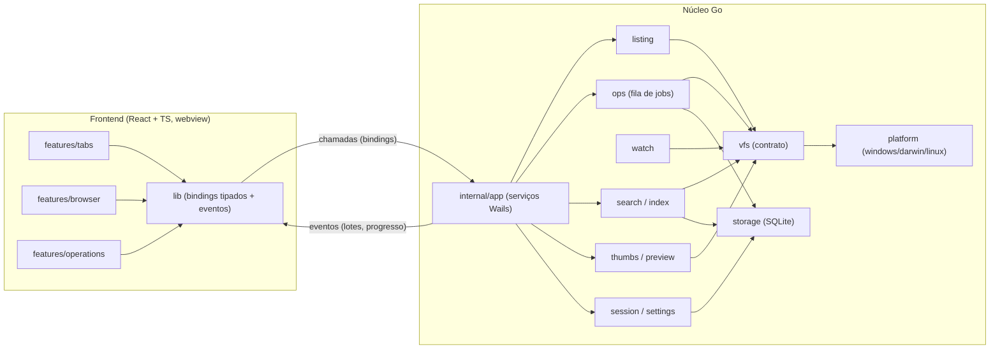
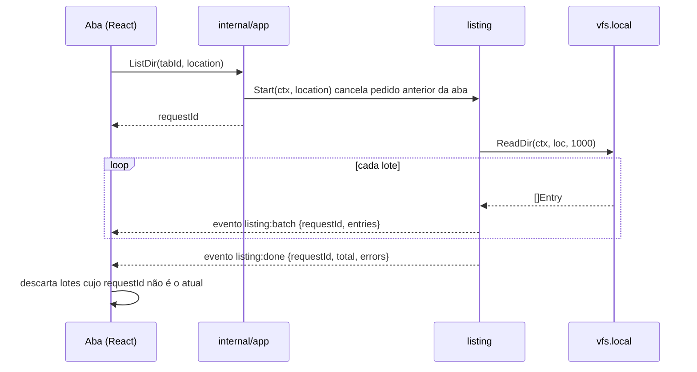
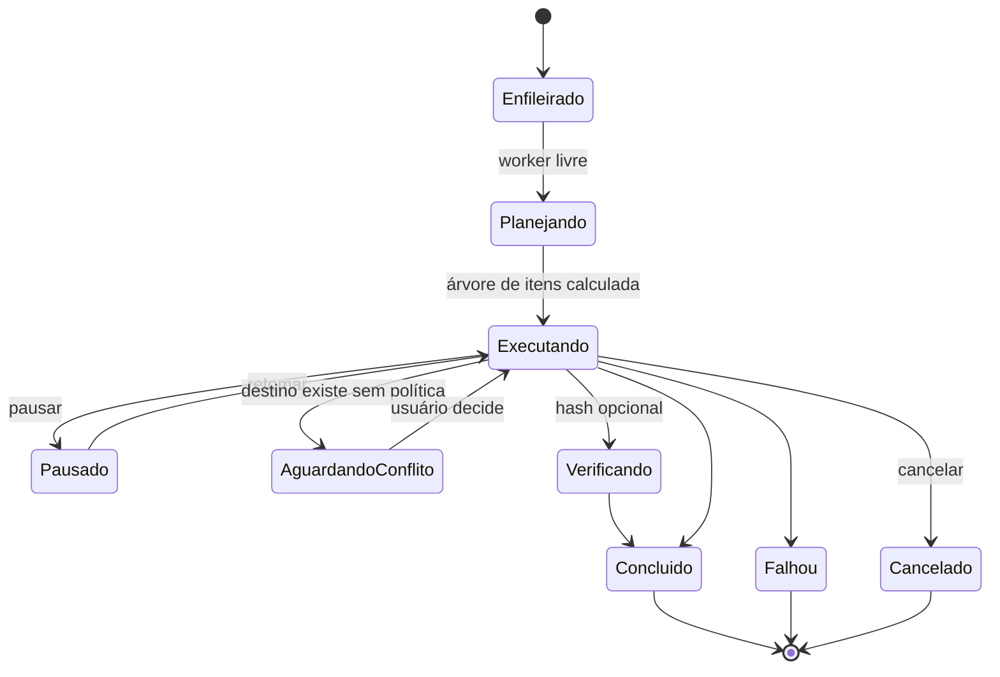
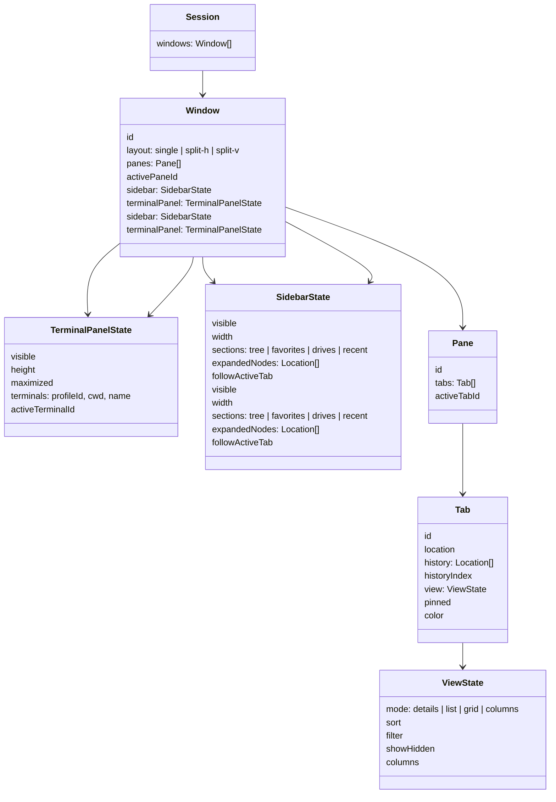
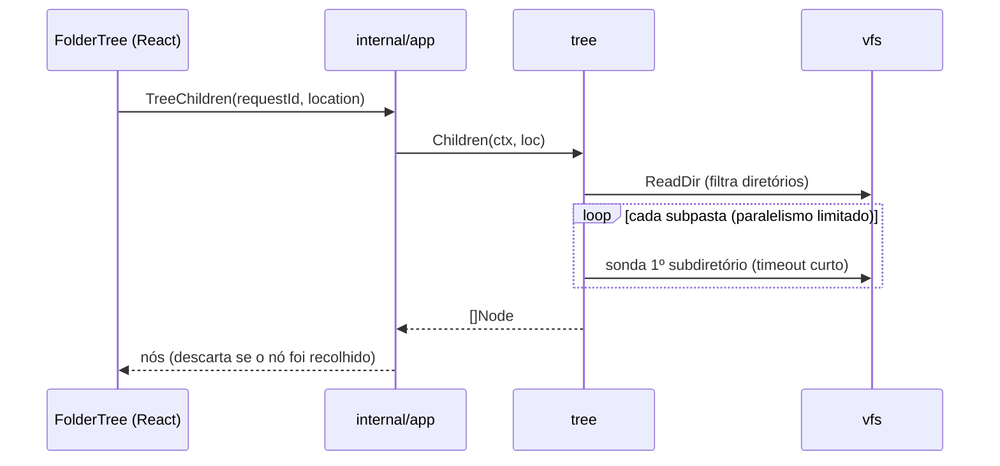
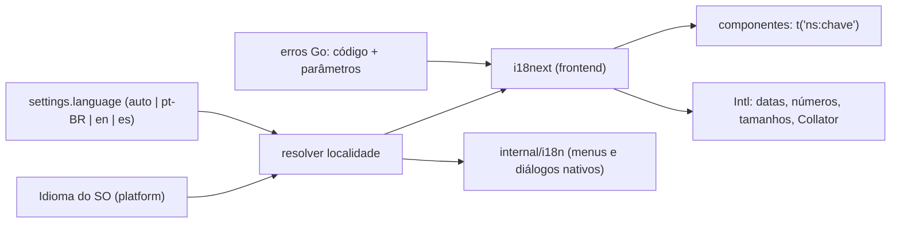

# Arquitetura

## Visão geral



Dois canais entre frontend e Go:

1. **Chamadas** (bindings Wails): pedidos curtos que retornam rápido — iniciar listagem, enfileirar operação, ler configuração. Operações longas **retornam um id imediatamente**.
2. **Eventos** (Wails `EventsEmit`): resultados progressivos — lotes de listagem, progresso de jobs, mudanças de diretório, resultados de busca. Todo evento carrega o id do pedido para que o frontend descarte respostas obsoletas.

## Contrato VFS

O núcleo nunca chama `os.*` diretamente fora de `vfs/local`. Todos os provedores implementam interfaces pequenas; capacidades opcionais são detectadas por *type assertion*.

```go
// internal/vfs
type Location struct {
    Provider string // "local", "zip", "sftp"...
    Root     string // ex.: "C:\\", "/", "sftp://host"
    Path     string // caminho normalizado dentro do provedor
}

type Entry struct {
    Name     string
    Location Location
    Kind     Kind      // File, Dir, Symlink, Other
    Size     int64
    ModTime  time.Time
    Attrs    Attrs     // oculto, sistema, somente leitura, executável
    Target   *Location // destino de symlink, se houver
}

type FileSystem interface {
    Stat(ctx context.Context, loc Location) (Entry, error)
    // ReadDir envia entradas em lotes; fecha o canal ao terminar ou cancelar.
    ReadDir(ctx context.Context, loc Location, batch int) (<-chan []Entry, <-chan error)
    Open(ctx context.Context, loc Location) (io.ReadCloser, error)
}

// Capacidades opcionais
type Writer interface {
    Create(ctx context.Context, loc Location) (io.WriteCloser, error)
    Mkdir(ctx context.Context, loc Location) error
    Rename(ctx context.Context, from, to Location) error
    Remove(ctx context.Context, loc Location) error
}
type Trasher interface { Trash(ctx context.Context, loc Location) error }
type Watcher interface { Watch(ctx context.Context, loc Location) (<-chan Change, error) }
```

Erros de domínio padronizados (`vfs.ErrNotFound`, `ErrPermission`, `ErrExists`, `ErrNotEmpty`, `ErrCrossDevice`, `ErrUnsupported`) são convertidos em códigos estáveis na fronteira Wails, e o frontend traduz o código para texto pt-BR.

## Fluxo: listar uma pasta



- A ordenação final é feita no **frontend** sobre os dados já recebidos (rápida, permite reordenar sem nova ida ao disco). Para pastas acima de um limiar (ex.: 50 mil), o Go pode enviar lotes já ordenados.
- Ordenação natural e comparação sem diferenciar maiúsculas seguem a regra do SO (configurável).
- Cache LRU de listagens por aba inativa, invalidado pelo watcher.

## Fluxo: operação de arquivo (job)



- **Planejamento** varre a origem e calcula total de bytes/itens (para ETA) antes de escrever qualquer coisa.
- **Escrita segura**: arquivo temporário (`.nome.pulsares-part`) no destino, `fsync`, rename atômico; preserva datas e permissões quando possível.
- **Concorrência**: por padrão um job por volume de destino em execução; demais aguardam (evita thrashing em HDD). Configurável.
- **Diário**: cada passo concluído é registrado no SQLite (`op_journal`). Permite desfazer (inverso de cada passo) e relatar o estado após travamento.
- Eventos `ops:progress` com taxa limitada (~10/s por job).

## Abas e sessão



- **Fonte da verdade em tempo de execução**: store Zustand no frontend (UI precisa reagir instantaneamente).
- **Persistência**: o frontend envia o snapshot da sessão ao Go (`SaveSession`) com debounce de ~1 s e ao fechar a janela; o Go grava no SQLite. Na abertura, `LoadSession` reidrata.
- A seleção e a rolagem são persistidas apenas para a aba ativa de cada painel (economia).
- Abas fechadas vão para uma pilha limitada (ex.: 25) para "reabrir aba fechada".

## Painel lateral e árvore de pastas

```text
┌───────────────┬──────────────────────────────────────────┐
│ ▸ Favoritos   │  [aba 1] [aba 2] [+]                     │
│ ▾ Este PC     │  ‹ › ↑  C: › Usuários › vitor            │
│   ▸ C:        │ ─────────────────────────────────────────│
│   ▾ D:        │  Nome            Tamanho  Modificado     │
│     ▸ Fotos   │  ...                                     │
│     ▾ Projetos│                                          │
│       ▸ api   │                                          │
│ ▸ Recentes    │                                          │
├───────────────┴──────────────────────────────────────────┤
│ 1.234 itens · 3 selecionados · 120 GB livres             │
└──────────────────────────────────────────────────────────┘
   ↑ recolhível (Ctrl+B / Cmd+B) e redimensionável
```

**Raízes por sistema** (fornecidas por `internal/platform`):

| SO | Raízes da árvore |
| --- | --- |
| Windows | Pasta pessoal, unidades (`C:\`, `D:\`…), locais de rede mapeados |
| macOS | Pasta pessoal, `/`, volumes em `/Volumes` |
| Linux | Pasta pessoal, `/`, pontos de montagem de mídias removíveis |

**Contrato Go** (`internal/tree`, exposto por `internal/app`):

```go
type Node struct {
    Name        string
    Location    vfs.Location
    HasChildren Tri  // Yes, No, Unknown
    IsLink      bool // symlink/junction: não expandir recursivamente
    Hidden      bool
}

// Roots retorna as raízes do SO.
Roots(ctx context.Context) ([]Node, error)
// Children lista somente subdiretórios, ordenados pela localidade do frontend
// (o frontend reordena com Intl.Collator), sondando HasChildren com limite de tempo.
Children(ctx context.Context, loc vfs.Location, showHidden bool) ([]Node, error)
```



Comportamento:

- **Frontend**: store `folder-tree` mantém um mapa `locationKey → { children, status, expanded }` e uma **lista achatada** dos nós visíveis, renderizada com TanStack Virtual.
- **Sincronização com o painel em foco**: a árvore é única por janela. Ao navegar ou ao trocar o foco entre painéis, ela expande os ancestrais da pasta da aba ativa do painel em foco (carregando sob demanda) e rola até ela, se `followActiveTab` estiver ligado. Clique em um nó navega na aba ativa do painel em foco.
- **Cache**: filhos ficam em memória enquanto o nó estiver expandido; nós recolhidos podem ser descartados (LRU). Atualização manual com `F5` no foco da árvore; automática por watcher na etapa 0.8.
- **Falhas**: permissão negada ou unidade indisponível mostram estado no próprio nó (ícone + texto acessível), sem diálogo modal.
- **Teclado**: `↑`/`↓` move, `→` expande/entra no primeiro filho, `←` recolhe/vai ao pai, `Enter` abre na aba ativa, `Ctrl+Enter` em nova aba, `*` expande um nível, digitação salta por nome.

## Internacionalização



- **Resolução**: `settings.language = "auto"` usa o idioma do SO (`GetUserDefaultLocaleName` no Windows, `NSLocale` no macOS, `LANG`/`LC_ALL` no Linux) mapeado para o idioma suportado mais próximo (`pt-*` → pt-BR, `es-*` → es, demais → en). Escolha manual vale imediatamente, sem reiniciar.
- **Catálogos**: JSON por idioma e namespace em `frontend/src/i18n/locales/<idioma>/<ns>.json`, carregados de forma estática no bundle (são pequenos; o app é offline). pt-BR é a referência; os tipos das chaves são gerados a partir dele para o TypeScript acusar chave inexistente.
- **Namespaces iniciais**: `common`, `navigation`, `tabs`, `tree`, `browser`, `ops`, `search`, `terminal`, `settings`, `errors`, `commands`.
- **Formatação**: utilitários em `i18n/format.ts` — `formatDate`, `formatRelative`, `formatNumber`, `formatBytes` (KB/MB com separador decimal da localidade), `collator` para ordenação natural. Reaproveitam instâncias `Intl` por localidade (custo de criação é alto).
- **Erros**: a fronteira Wails devolve `{ code, params }`; o frontend mapeia para `errors:<code>`. Logs usam o código, nunca o texto traduzido.
- **Lado Go**: `internal/i18n` contém apenas textos nativos (menu da aplicação no macOS, títulos de diálogos nativos, notificações), em JSON embutido com as mesmas regras de chaves. Recebe a localidade ativa via `SetLanguage`.
- **Qualidade**: `npm run i18n:check` compara chaves entre idiomas (faltantes e órfãs) e roda no job de qualidade do `release.yml`. Uma pseudo-localidade de desenvolvimento (`[!! Ţéxţö !!]`) ajuda a achar strings fixas e textos cortados.

## Terminal integrado

```text
┌───────────┬──────────────────────────────────────────────┐
│ árvore    │  abas de pastas / conteúdo                   │
│           │                                              │
│           ├──────────────────────────────────────────────┤ ← divisor arrastável
│           │ TERMINAL  [pwsh ×] [bash ×] [+ ▾]  ⊟ ⤢ ✕    │
│           │ PS D:\Projetos\api> git status               │
│           │ ...                                          │
└───────────┴──────────────────────────────────────────────┘
   Ctrl+` abre/fecha · Ctrl+Shift+` novo terminal
```

**Backend** (`internal/terminal`):

```go
type Profile struct {
    ID, Name string
    Path     string   // executável do shell
    Args     []string
    Env      map[string]string
    Kind     ShellKind // PowerShell, Cmd, Posix (bash/zsh/sh), Fish, WSL
}

type Manager interface {
    Profiles(ctx context.Context) ([]Profile, error)          // detectados + personalizados
    Start(profileID string, cwd string, cols, rows int) (SessionID, error)
    Write(id SessionID, data []byte) error                     // teclado / colar
    Resize(id SessionID, cols, rows int) error
    Kill(id SessionID) error                                   // encerra a árvore de processos
    HasRunningChildren(id SessionID) (bool, error)             // aviso ao fechar
}
```

- **Pseudoterminal**: ConPTY no Windows 10 1809+ e `openpty` no Linux/macOS, por uma biblioteca Go multiplataforma (ex.: `aymanbagabas/go-pty`), isolada atrás da interface acima. Decisão em ADR-0007.
- **Fluxo de saída**: uma goroutine lê o PTY e acumula bytes; envia o evento `terminal:data {id, chunk}` a cada ~8 ms ou 64 KB (o que vier primeiro). Isso evita milhares de eventos por segundo em saídas intensas.
- **Contrapressão**: se o frontend acumular mais que um limite (ex.: 1 MB não confirmado), o Go pausa a leitura até o frontend confirmar (`Ack(id, bytes)`); o processo do shell é naturalmente freado pelo PTY.
- **Codificação**: bytes UTF-8 crus em base64 no evento (seguro para sequências parciais); o xterm.js decodifica. No Windows, o perfil força UTF-8 (`chcp 65001` / `$OutputEncoding`) quando suportado.
- **Encerramento**: Windows usa *Job Object* para matar toda a árvore de processos; Unix usa grupo de processos (`setsid` + sinal ao grupo).
- **Ambiente**: herda o ambiente do usuário, acrescenta `TERM=xterm-256color`, `COLORTERM=truecolor` e `TERM_PROGRAM=PulsaresExplorer`.

**Detecção de perfis**:

| SO | Perfis detectados (ordem do padrão) |
| --- | --- |
| Windows | PowerShell 7 (`pwsh`), Windows PowerShell, Prompt de Comando, Git Bash, distribuições WSL (`wsl -l -q`) |
| macOS | `$SHELL` (normalmente zsh), bash, fish se instalado |
| Linux | `$SHELL`, entradas válidas de `/etc/shells` (bash, zsh, fish…) |

**Frontend** (`features/terminal`):

- **xterm.js** com complementos `fit` (ajuste ao painel), `webgl` (com alternativa para canvas/DOM), `search`, `web-links` e `unicode11`.
- Store `terminal` com sessões, aba ativa, divisões, visibilidade e altura do painel; instâncias do xterm mantidas vivas ao ocultar o painel (não recriar).
- Redimensionamento com debounce chama `Resize`; o painel usa a mesma infraestrutura de regiões do layout.
- **Tema** derivado dos tokens claro/escuro (16 cores ANSI + fundo/cursor/seleção definidos em `ui/tokens.css`).
- **Atalhos**: quando o foco está no terminal, as teclas vão para o shell, exceto uma lista reservada (`` Ctrl+` ``, `Ctrl+Shift+C/V`, `Ctrl+Shift+F`, troca de abas do terminal), configurável.

**Integração com o explorador**:

- **Abrir na pasta**: `Start` recebe a pasta da aba ativa (apenas provedor `local`; em outros provedores usa a pasta pessoal).
- **Ir para a pasta atual**: o Go monta o comando com citação correta por `ShellKind` (`Set-Location -LiteralPath '...'`, `cd /d "..."`, `cd -- '...'`) e envia via `Write`; nunca concatenar caminhos sem citação.
- **Arrastar arquivos** da lista para o terminal insere os caminhos citados, separados por espaço, sem executar.
- **Explorador segue o terminal** (opcional): scripts de integração de shell emitem `OSC 7` (`file://host/caminho`) a cada prompt; o frontend detecta e oferece/realiza a navegação da aba vinculada. Os scripts são injetados apenas se o usuário ativar a opção.
- **Links**: caminhos detectados na saída (relativos à pasta atual do terminal) abrem no explorador; URLs abrem no navegador do sistema.

**Privacidade e segurança**:

- O conteúdo do terminal (entrada e saída) **nunca** é registrado em log, persistido ou enviado para fora.
- Persistem apenas metadados: perfil, pasta inicial, nome da aba, layout do painel. Processos não são restaurados.
- O app nunca executa comandos por conta própria; ações como "Ir para a pasta atual" apenas digitam texto e são sempre iniciadas pelo usuário.

## Painel lateral e árvore de pastas

```text
┌───────────────┬──────────────────────────────────────────┐
│ ▸ Favoritos   │  [aba 1] [aba 2] [+]                     │
│ ▾ Este PC     │  ‹ › ↑  C: › Usuários › vitor            │
│   ▸ C:        │ ─────────────────────────────────────────│
│   ▾ D:        │  Nome            Tamanho  Modificado     │
│     ▸ Fotos   │  ...                                     │
│     ▾ Projetos│                                          │
│       ▸ api   │                                          │
│ ▸ Recentes    │                                          │
├───────────────┴──────────────────────────────────────────┤
│ 1.234 itens · 3 selecionados · 120 GB livres             │
└──────────────────────────────────────────────────────────┘
   ↑ recolhível (Ctrl+B / Cmd+B) e redimensionável
```

**Raízes por sistema** (fornecidas por `internal/platform`):

| SO | Raízes da árvore |
| --- | --- |
| Windows | Pasta pessoal, unidades (`C:\`, `D:\`…), locais de rede mapeados |
| macOS | Pasta pessoal, `/`, volumes em `/Volumes` |
| Linux | Pasta pessoal, `/`, pontos de montagem de mídias removíveis |

**Contrato Go** (`internal/tree`, exposto por `internal/app`):

```go
type Node struct {
    Name        string
    Location    vfs.Location
    HasChildren Tri  // Yes, No, Unknown
    IsLink      bool // symlink/junction: não expandir recursivamente
    Hidden      bool
}

// Roots retorna as raízes do SO.
Roots(ctx context.Context) ([]Node, error)
// Children lista somente subdiretórios, ordenados pela localidade do frontend
// (o frontend reordena com Intl.Collator), sondando HasChildren com limite de tempo.
Children(ctx context.Context, loc vfs.Location, showHidden bool) ([]Node, error)
```


Comportamento:

- **Frontend**: store `folder-tree` mantém um mapa `locationKey → { children, status, expanded }` e uma **lista achatada** dos nós visíveis, renderizada com TanStack Virtual.
- **Sincronização com o painel em foco**: a árvore é única por janela. Ao navegar ou ao trocar o foco entre painéis, ela expande os ancestrais da pasta da aba ativa do painel em foco (carregando sob demanda) e rola até ela, se `followActiveTab` estiver ligado. Clique em um nó navega na aba ativa do painel em foco.
- **Cache**: filhos ficam em memória enquanto o nó estiver expandido; nós recolhidos podem ser descartados (LRU). Atualização manual com `F5` no foco da árvore; automática por watcher na etapa 0.8.
- **Falhas**: permissão negada ou unidade indisponível mostram estado no próprio nó (ícone + texto acessível), sem diálogo modal.
- **Teclado**: `↑`/`↓` move, `→` expande/entra no primeiro filho, `←` recolhe/vai ao pai, `Enter` abre na aba ativa, `Ctrl+Enter` em nova aba, `*` expande um nível, digitação salta por nome.

## Internacionalização


- **Resolução**: `settings.language = "auto"` usa o idioma do SO (`GetUserDefaultLocaleName` no Windows, `NSLocale` no macOS, `LANG`/`LC_ALL` no Linux) mapeado para o idioma suportado mais próximo (`pt-*` → pt-BR, `es-*` → es, demais → en). Escolha manual vale imediatamente, sem reiniciar.
- **Catálogos**: JSON por idioma e namespace em `frontend/src/i18n/locales/<idioma>/<ns>.json`, carregados de forma estática no bundle (são pequenos; o app é offline). pt-BR é a referência; os tipos das chaves são gerados a partir dele para o TypeScript acusar chave inexistente.
- **Namespaces iniciais**: `common`, `navigation`, `tabs`, `tree`, `browser`, `ops`, `search`, `terminal`, `settings`, `errors`, `commands`.
- **Formatação**: utilitários em `i18n/format.ts` — `formatDate`, `formatRelative`, `formatNumber`, `formatBytes` (KB/MB com separador decimal da localidade), `collator` para ordenação natural. Reaproveitam instâncias `Intl` por localidade (custo de criação é alto).
- **Erros**: a fronteira Wails devolve `{ code, params }`; o frontend mapeia para `errors:<code>`. Logs usam o código, nunca o texto traduzido.
- **Lado Go**: `internal/i18n` contém apenas textos nativos (menu da aplicação no macOS, títulos de diálogos nativos, notificações), em JSON embutido com as mesmas regras de chaves. Recebe a localidade ativa via `SetLanguage`.
- **Qualidade**: `npm run i18n:check` compara chaves entre idiomas (faltantes e órfãs) e roda no job de qualidade do `release.yml`. Uma pseudo-localidade de desenvolvimento (`[!! Ţéxţö !!]`) ajuda a achar strings fixas e textos cortados.

## Terminal integrado

```text
┌───────────┬──────────────────────────────────────────────┐
│ árvore    │  abas de pastas / conteúdo                   │
│           │                                              │
│           ├──────────────────────────────────────────────┤ ← divisor arrastável
│           │ TERMINAL  [pwsh ×] [bash ×] [+ ▾]  ⊟ ⤢ ✕    │
│           │ PS D:\Projetos\api> git status               │
│           │ ...                                          │
└───────────┴──────────────────────────────────────────────┘
   Ctrl+` abre/fecha · Ctrl+Shift+` novo terminal
```

**Backend** (`internal/terminal`):

```go
type Profile struct {
    ID, Name string
    Path     string   // executável do shell
    Args     []string
    Env      map[string]string
    Kind     ShellKind // PowerShell, Cmd, Posix (bash/zsh/sh), Fish, WSL
}

type Manager interface {
    Profiles(ctx context.Context) ([]Profile, error)          // detectados + personalizados
    Start(profileID string, cwd string, cols, rows int) (SessionID, error)
    Write(id SessionID, data []byte) error                     // teclado / colar
    Resize(id SessionID, cols, rows int) error
    Kill(id SessionID) error                                   // encerra a árvore de processos
    HasRunningChildren(id SessionID) (bool, error)             // aviso ao fechar
}
```

- **Pseudoterminal**: ConPTY no Windows 10 1809+ e `openpty` no Linux/macOS, por uma biblioteca Go multiplataforma (ex.: `aymanbagabas/go-pty`), isolada atrás da interface acima. Decisão em ADR-0007.
- **Fluxo de saída**: uma goroutine lê o PTY e acumula bytes; envia o evento `terminal:data {id, chunk}` a cada ~8 ms ou 64 KB (o que vier primeiro). Isso evita milhares de eventos por segundo em saídas intensas.
- **Contrapressão**: se o frontend acumular mais que um limite (ex.: 1 MB não confirmado), o Go pausa a leitura até o frontend confirmar (`Ack(id, bytes)`); o processo do shell é naturalmente freado pelo PTY.
- **Codificação**: bytes UTF-8 crus em base64 no evento (seguro para sequências parciais); o xterm.js decodifica. No Windows, o perfil força UTF-8 (`chcp 65001` / `$OutputEncoding`) quando suportado.
- **Encerramento**: Windows usa *Job Object* para matar toda a árvore de processos; Unix usa grupo de processos (`setsid` + sinal ao grupo).
- **Ambiente**: herda o ambiente do usuário, acrescenta `TERM=xterm-256color`, `COLORTERM=truecolor` e `TERM_PROGRAM=PulsaresExplorer`.

**Detecção de perfis**:

| SO | Perfis detectados (ordem do padrão) |
| --- | --- |
| Windows | PowerShell 7 (`pwsh`), Windows PowerShell, Prompt de Comando, Git Bash, distribuições WSL (`wsl -l -q`) |
| macOS | `$SHELL` (normalmente zsh), bash, fish se instalado |
| Linux | `$SHELL`, entradas válidas de `/etc/shells` (bash, zsh, fish…) |

**Frontend** (`features/terminal`):

- **xterm.js** com complementos `fit` (ajuste ao painel), `webgl` (com alternativa para canvas/DOM), `search`, `web-links` e `unicode11`.
- Store `terminal` com sessões, aba ativa, divisões, visibilidade e altura do painel; instâncias do xterm mantidas vivas ao ocultar o painel (não recriar).
- Redimensionamento com debounce chama `Resize`; o painel usa a mesma infraestrutura de regiões do layout.
- **Tema** derivado dos tokens claro/escuro (16 cores ANSI + fundo/cursor/seleção definidos em `ui/tokens.css`).
- **Atalhos**: quando o foco está no terminal, as teclas vão para o shell, exceto uma lista reservada (`` Ctrl+` ``, `Ctrl+Shift+C/V`, `Ctrl+Shift+F`, troca de abas do terminal), configurável.

**Integração com o explorador**:

- **Abrir na pasta**: `Start` recebe a pasta da aba ativa (apenas provedor `local`; em outros provedores usa a pasta pessoal).
- **Ir para a pasta atual**: o Go monta o comando com citação correta por `ShellKind` (`Set-Location -LiteralPath '...'`, `cd /d "..."`, `cd -- '...'`) e envia via `Write`; nunca concatenar caminhos sem citação.
- **Arrastar arquivos** da lista para o terminal insere os caminhos citados, separados por espaço, sem executar.
- **Explorador segue o terminal** (opcional): scripts de integração de shell emitem `OSC 7` (`file://host/caminho`) a cada prompt; o frontend detecta e oferece/realiza a navegação da aba vinculada. Os scripts são injetados apenas se o usuário ativar a opção.
- **Links**: caminhos detectados na saída (relativos à pasta atual do terminal) abrem no explorador; URLs abrem no navegador do sistema.

**Privacidade e segurança**:

- O conteúdo do terminal (entrada e saída) **nunca** é registrado em log, persistido ou enviado para fora.
- Persistem apenas metadados: perfil, pasta inicial, nome da aba, layout do painel. Processos não são restaurados.
- O app nunca executa comandos por conta própria; ações como "Ir para a pasta atual" apenas digitam texto e são sempre iniciadas pelo usuário.

## Persistência (SQLite)

Arquivo em diretório de dados do usuário (`os.UserConfigDir()/PulsaresExplorer/`). Migrações versionadas e embutidas (`embed.FS`), aplicadas na inicialização, com teste de upgrade.

Tabelas iniciais previstas:

| Tabela | Conteúdo |
| --- | --- |
| `schema_migrations` | versão aplicada |
| `settings` | chave/valor JSON (inclui `language`: `auto`, `pt-BR`, `en`, `es`) |
| `keybindings` | comando → atalho |
| `session` | snapshot JSON da sessão |
| `closed_tabs` | pilha de abas fechadas |
| `favorites` | locais favoritos ordenados |
| `history` | pastas visitadas (frequência/recência) |
| `tags`, `file_tags` | etiquetas locais por caminho (+ id de arquivo quando disponível) |
| `op_journal` | diário de operações para desfazer/recuperar |
| `index_roots`, `index_entries` (FTS5) | índice de busca opcional |

## Camada de plataforma

| Recurso | Windows | macOS | Linux |
| --- | --- | --- | --- |
| Lixeira | `IFileOperation` (COM) | `NSFileManager trashItemAtURL` | freedesktop Trash spec |
| Volumes | `GetLogicalDrives`, `GetVolumeInformation` | `/Volumes`, `statfs` | `/proc/self/mountinfo`, UDisks2 (D-Bus) |
| Abrir padrão | `ShellExecuteW` | `open` / `NSWorkspace` | `xdg-open` / `gio open` |
| "Abrir com" | `SHAssocEnumHandlers` | `LSCopyApplicationURLsForURL` | MIME + arquivos `.desktop` |
| Ícones do sistema | `SHGetFileInfo` / `IShellItemImageFactory` | `NSWorkspace iconForFile` | tema de ícones freedesktop |
| Menu de contexto | `IContextMenu` | serviços (limitado) | não há padrão (ações próprias) |
| Atributos | oculto/sistema via atributos | `UF_HIDDEN` + ponto | nome iniciado por ponto |
| Idioma do sistema | `GetUserDefaultLocaleName` | `NSLocale.preferredLanguages` | `LC_ALL` / `LC_MESSAGES` / `LANG` |
| Pseudoterminal | ConPTY + Job Object | `openpty` + grupo de processos | `openpty` + grupo de processos |
| Idioma do sistema | `GetUserDefaultLocaleName` | `NSLocale.preferredLanguages` | `LC_ALL` / `LC_MESSAGES` / `LANG` |
| Pseudoterminal | ConPTY + Job Object | `openpty` + grupo de processos | `openpty` + grupo de processos |
| Watcher | `ReadDirectoryChangesW` (via fsnotify) | FSEvents / kqueue | inotify |

Código em `internal/platform/<so>` com build tags e uma interface comum em `internal/platform`. Recursos sem suporte retornam `vfs.ErrUnsupported` e a UI oculta a ação.

## Frontend

- `app/`: compõe janela → painéis → abas; registra atalhos globais e a paleta de comandos.
- **Registro de comandos** central (`id`, título pt-BR, atalho padrão, `when` contextual, handler). Menus, paleta, atalhos e barra de ferramentas usam o mesmo registro — nada de handlers duplicados.
- `lib/`: única camada que importa `wailsjs`; expõe funções tipadas e um `subscribe(evento, handler)` que filtra por `requestId`.
- Listas: TanStack Virtual; linhas memoizadas; nenhum `Array.sort` dentro de render.
- Estilo: CSS com variáveis (tokens) em `ui/tokens.css`; componentes base em `ui/`.

## Riscos técnicos conhecidos

| Risco | Mitigação |
| --- | --- |
| Wails v2 tem janela única | Abas + painéis cobrem o uso; multi-janela adiada para avaliação de Wails v3 (ADR-0004) |
| Arrastar arquivos **para fora** do app (para outros programas) não é nativo no Wails v2 | Implementar via código nativo por SO na etapa 0.8; até lá, copiar/colar com a área de transferência do SO |
| Menu de contexto nativo do Windows exige COM | Etapa dedicada (0.8), isolado em `platform/windows`, opcional |
| Saída intensa do terminal saturar a ponte Wails (eventos) | Lotes de ~8 ms/64 KB, base64, contrapressão com `Ack`, renderização WebGL |
| ConPTY indisponível (Windows anterior ao 10 1809) | Terminal desativado com mensagem clara; o restante do app funciona |
| Pastas de rede lentas travarem listagem | Tudo cancelável, timeouts, indicador de carregamento por aba |
| Webview com listas enormes | Virtualização + lotes + payload mínimo por entrada |
